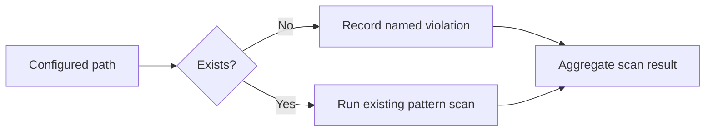
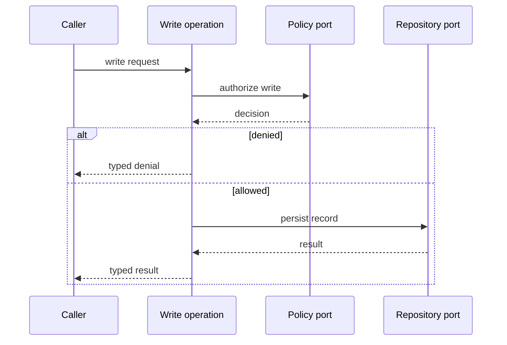

# Research: Plan craft — architecture before the work schedule

Date: 2026-10-31. Analysis only; no templates, jobs, contracts, or gates changed.

## Summary

The plan should explain the chosen approach, then show the architecture from overview to mechanism, then provide an executable, traceable work schedule. Use ISO 42010's stakeholder → concern → viewpoint → view discipline to select useful explanations, not to mandate four diagrams for every change; preserve the existing metadata, STEP records, acceptance coverage, compatibility, and recovery obligations.

The proposed house style is Mermaid embedded in Markdown, with no minimum diagram count. High-level architecture, technical architecture, and runtime flow are distinct reading needs, but a small plan can satisfy them with a few precise sentences rather than three decorative pictures.

## Evidence and method

Research angles: architecture-description obligations; narrative design-document practice; diagram selection and rendering; compatibility with local artifact validation. External sources were fetched and inspected, not treated as verified from search summaries alone.

Local sources read:
- `docs/research/software-constitution/05-spec-craft-analysis.md`, especially “Plan — nine principles,” the plan diagnosis, and validator limits.
- `docs/research/software-constitution/proposed-templates/plan.md` in full.
- `.engram-factory/jobs/011-en004-fail-closed/plan.md` in full.
- `tools/ci/check_job_artifacts.py` in full.
- `.agents/skills/engram-factory/scripts/factory.py:1–180`, including `metadata` and `validate_artifact`.
- `tools/hooks/index-mining.py` in full.

**Execution limitation:** no shell or engram MCP tool was exposed, so the index-mining command, live index queries, and strict index-evidence validator could not run. This is **index unavailable**, not “index empty”; no index results are invented. Source-check retrieved passages but reported automated semantic assessment unavailable; I manually inspected original IEEE scope and standard text instead. Diagram examples below were source-reviewed, not render-tested.

## Findings

### 1. ISO 42010 distilled: explain whose question each view answers

**Claim:** Architecture description is a communication contract, not a prescribed diagram pack. **Sources:** [IEEE's 2022 synopsis](https://standards.ieee.org/ieee/42010/6846/), [ISO committee's 2011 synopsis](https://committee.iso.org/sites/jtc1sc7/home/projects/flagship-standards/isoiecieee-420102011.html), [2011 text, §§3–5, 7](https://wildart.github.io/MISG5020/standards/IEEE-42010-2011.pdf). **Support:** direct evidence. **Confidence:** high, with edition limits below.

- **Stakeholder:** person, team, organization, or class with an interest in the system.
- **Concern:** an interest relevant to those stakeholders, such as maintainability, security, reliability, or feasibility.
- **Viewpoint:** conventions for constructing/interpreting a view and the concerns it frames. It is the lens, not the drawing.
- **View:** the architecture description under that lens; it comprises models addressing those concerns. A diagram is a model, not automatically a whole view.
- **Model kind:** conventions for a type of model; a sequence diagram and a dependency graph serve different questions.

**What an AD must contain — edition-qualified:** the inspected **2011** §5 requires identification/overview; relevant stakeholders and their associated concerns; included viewpoints; corresponding views and models; applicable correspondence rules/correspondences and known inconsistencies; and architecture rationale. Each identified concern must be framed by at least one viewpoint; each used viewpoint has exactly one view, potentially containing several models. Viewpoint rationale and rationale for key decisions are required; evidence of alternatives is a “should,” not an unconditional “shall.” Information can be included by reference. Viewpoint conventions themselves have §7 obligations.

**Edition boundary:** the current **2022** official IEEE/IEC synopses confirm requirements for AD structure/expression, viewpoints, and model kinds, and explicitly reject prescribing processes, notation, tools, format, or media. The full 2022 clauses were not inspected. Thus this is an ISO-informed adaptation, **not a claim that the proposed template conforms to 2022**, nor that the 2011 clause inventory is a verbatim 2022 checklist.

**Researcher recommendation:** precede each selected view with one line: “For [stakeholder], this [viewpoint] explains [concern]; scope [boundary], notation [kind].” Use stable component names across views and identify unresolved contradictions. This earns the diagram its place without adding a separate stakeholder bureaucracy.

### 2. S/M/L selects explanation depth, not ceremonial drawing counts

**Claim:** View selection should follow concerns; small jobs can omit diagrams without omitting architecture reasoning. **Sources:** ISO sources above; [C4 diagram guide](https://c4model.com/diagrams), [Google design-doc practitioner account](https://www.industrialempathy.com/posts/design-docs-at-google/). **Support:** interpretation; the following tier rules are researcher recommendations, not standards mandates. **Confidence:** medium.

| Viewpoint / question | Concern and stakeholder | S | M | L |
|---|---|---|---|---|
| System context: where is the boundary? | Owner/integrator: affected users, neighboring systems, trust and scope | One boundary sentence; diagram only for a changed external/trust boundary | Context diagram when integration scope changes; otherwise reference current context | Explicit context view, reusing a current diagram if unchanged |
| Structural: who owns what, and who depends on whom? | Developer/architecture reviewer: responsibilities, portability, change isolation | Name existing seam and concrete module/path; no whole-repository map | Changed-component view; container view only for application/data-store boundaries | High-level container/system view plus focused component refinement where needed |
| Runtime: what happens and what happens on failure? | Implementer/security/test reviewer: ordering, policy enforcement, data movement, partial failure | Brief success/failure prose; diagram only if branching or order is non-obvious | One representative changed flow; add critical denial/failure branch | Principal cross-boundary flow and material failure/concurrency cases; split concerns |
| Deployment: where does it run, and what fails together? | Operations/platform: topology, trust, configuration, rollout, availability | Omit unless deployment/topology changes | Draw only when placement, process boundary, or operational risk changes | Explicit applicability decision; draw changed topology/failure domains, not automatically every environment |

A security-sensitive S change still earns a trust-boundary or failure-flow view. A large pure library refactor need not invent deployment infrastructure. A changed boundary outranks a size label; an unchanged view can be linked with an explanation of why it still applies.

For engram specifically, distinguish core ports, adapter cells, backend recipes, and SDK/transports when those seams change. Do not draw a Rust crate as a C4 container merely because it has a box: C4 containers represent applications or data stores, not generic modules or necessarily Docker containers. [C4 container guide](https://c4model.com/diagrams/container) is direct evidence for that distinction.

### 3. Narrative carries the argument; the plan owns structural choices

**Claim:** A technical design should start with an overview, explain mechanism and alternatives, and keep requirements distinct from design. **Sources:** [Design Docs at Google](https://www.industrialempathy.com/posts/design-docs-at-google/), [Amazon shareholder letter](https://www.aboutamazon.com/news/company-news/amazon-ceo-andy-jassy-2024-letter-to-shareholders), [Amazon-hosted Working Backwards excerpt](https://www.aboutamazon.com/news/workplace/an-insider-look-at-amazons-culture-and-processes). **Support:** direct evidence for described practices; interpretation for engram's artifact split. **Confidence:** high for sources, medium for transfer.

The Google practitioner account describes high-level implementation strategy, overview-to-detail design, credible alternatives, and tradeoffs; it explicitly says context is not a requirements document and allows mini-docs. Amazon's official letter describes narratives with a **maximum**, not a target, of six body pages; the Working Backwards excerpt warns against showing all the work rather than distilling it. Neither establishes a universal ban on lists or tables.

**Researcher recommendation:** spec = observable behavior, invariants, requirements, and acceptance; plan = chosen structure, collaborations, ownership, implementation tradeoffs, sequencing, and recovery. Runtime behavior appears in the plan to explain how the architecture realizes the spec, not to redefine canonical requirements. This split is an engram design choice, not a universal definition of documents named “spec.”

Lead with: chosen seam → mechanism → invariant preserved → accepted cost → why a credible alternative loses. Consume binding `DEC-*` by reference; give newly delegated choices rationale and authority. For a fully constrained S fix, say no meaningful alternative remains rather than manufacturing an options essay.

### 4. Redesigned plan skeleton

**Claim:** The proposed body can be architecture-led while preserving the current parser contract. **Sources:** local proposed plan, job 011 plan, `factory.py:77–133`, `check_job_artifacts.py:22–69`. **Support:** interpretation from source inspection, not executed compatibility testing. **Confidence:** medium.

Tier markers: **[All]** = always represented, possibly one sentence; **[M/L]** = expand when applicable; **[Conditional]** = omit an irrelevant subsection rather than fill dummy rows.

| Order / section | Tier | One-line purpose |
|---|---|---|
| Existing versioned frontmatter + title | All | Preserve identity, provenance, tier, spec/input hashes, status, ownership role, and constitutional references unchanged. |
| 1. Proposed approach | All | Explain the design argument, existing seam, preserved invariant, tradeoff, and binding decisions **before any diagram**. |
| 2. High-level architecture | All; diagrams conditional | Explain system boundary, affected stakeholders/concerns, responsibilities, and unchanged context; add context/container view only if useful. |
| 3. Technical architecture | All; expand M/L | Locate concrete modules/ports/adapters, dependency direction, state ownership, API/data changes, policy points, and significant error behavior. |
| 4. Runtime flows | All; diagrams conditional | Walk the principal success and material failure paths; use flowchart/sequence when prose would obscure control or order. |
| 5. Alternatives and consequential decisions | All; merge into §1 for S | Explain plausible rejected shapes, selection criteria, costs, and new decision authority; never just list labels. |
| 6. Contracts, compatibility, and blast radius | All | Classify affected contracts and consumers, transport parity, migration, dependencies, and concrete failure impact. |
| 7. Implementation sequence | All | Explain dependency/uncertainty-driven ordering, then retain the STEP table with REQ/rule IDs, paths, gates, and rollback. |
| 8. Acceptance-to-evidence map | All | Account for every spec AC with STEP IDs, GATE IDs, and explicit authorized omissions/deviations; explain what gates actually prove. |
| 9. Rollout, rollback, and recovery | All; deployment view conditional | State partial-failure condition, stop/escalation trigger, rollout ordering, revert limits, and any persisted-state recovery. |
| 10. Open decisions and known inconsistencies | Conditional | Record unresolved assumptions, cross-view conflicts, owner, and required resolution before implementation. |

Sections 2–4 are separate reading lenses, not three mandatory Mermaid fences. S can have very short sections and merge alternatives into the approach; M expands the changed structural and runtime seams; L may split technical subsections and link durable ADRs. Deployment belongs with rollout unless its placement is the main architectural decision. Do not introduce a new frontmatter union or field solely to carry these headings.

### 5. Diagram-selection and house-style rules

**Claim:** Diagram kinds answer different questions; Mermaid code fences are supported by GitHub Markdown. **Sources:** [C4 container](https://c4model.com/diagrams/container), [dynamic](https://c4model.com/diagrams/dynamic), [deployment](https://c4model.com/diagrams/deployment), [GitHub diagram documentation](https://docs.github.com/en/get-started/writing-on-github/working-with-advanced-formatting/creating-diagrams). **Support:** direct evidence for semantics/rendering; recommendations below are local. **Confidence:** high for capabilities, medium for numerical limits.

- **Flowchart:** branching, validation, policy checks, fallback, state/progression decisions. Arrows describe control or data explicitly; do not imply timing guarantees.
- **Sequence:** ordering among participants, request/response, asynchronous handoff, retries, denial, partial failure. Use `alt` for the material branch, not every possible exception.
- **C4 context:** people, system under design, and directly connected external systems; no crates, tables, or method calls.
- **C4 container:** applications/data stores and communications inside a system; not a substitute for a component diagram or deployment topology.
- **Component/dependency view:** internal modules, ports, adapters, ownership, and permitted dependency direction. Label arrow semantics; dependency direction is not request direction.
- **Deployment:** environment-specific runtime instances mapped to infrastructure, process/trust boundaries, and failure domains; only when these answer a real operational concern.

**Anti-ceremony:** S: no class inventory, full C4 hierarchy, or deployment drawing for a local gate patch. M: no repeated whole-system map or sequence for every method. L: no single everything-diagram, every-endpoint flow, or copied unchanged environment topology. Across tiers, a three-arrow picture that merely repeats the previous sentence can be deleted.

**Proposed house rules (not ISO/C4 limits):**
1. Use fenced `mermaid` blocks in the plan. Their textual source is diffable and greppable; keep stable node IDs and meaningful labels. No image-only canonical architecture.
2. Target **at most 8 boxes/participants per diagram** and about **12 sequence messages**; split at a real boundary when more are needed. Exceptions require a readability reason, not another gate.
3. One primary concern per diagram; include only collaborators needed to answer it. Caption stakeholder, concern, scope, and whether this is current/proposed/delta.
4. Keep abstraction levels separate. Label crossings and arrows; explain missing/unchanged context and map important nodes to concrete paths in adjacent prose.
5. Prefer basic `flowchart` and `sequenceDiagram`. Plain Mermaid shapes can express C4-inspired views with explicit types/legend; do not claim full C4 notation or rely on specialized syntax without checking GitHub's Mermaid version.
6. Check the rendered result on GitHub, not only the source. Avoid decorative colors, HTML, plugins, or enormous labels; never make color the only meaning carrier.
7. Teach with small, populated examples in author guidance; do not ship placeholder diagrams in completed plans.

**Worked S example — illustrative design, not a reproduced execution result.** Collect missing configured scan paths as violations in the existing scan; retain pattern checks. A separate preflight would add another traversal without changing the intended outcome. For job 011, prose alone is probably sufficient; this optional flowchart earns space only if the reviewer needs the fail-closed branch explained.

For the gate maintainer, this control-flow view explains the missing-path decision; scope is the changed branch, with existing pattern checks preserved on present paths.

**Worked M example — illustrative, not a claim about current implementation.** For a security reviewer, this runtime view asks whether authorization precedes persistence; concrete participant-to-module mapping belongs immediately beside an actual plan diagram.

### 6. What must not be lost

**Claim:** Architecture prose can replace template scaffolding, but it cannot replace traceable execution obligations. **Sources:** local proposed plan and job 011; both validator implementations. **Support:** direct evidence for existing fields/checks; interpretation for preservation guidance. **Confidence:** high.

- Retain STEP table columns: `ID | Implement | REQ IDs | Rule IDs | Concrete paths | Verify (GATE-ID / command) | Rollback`. Steps must produce reviewable outcomes; paths cannot be generic “core changes.”
- Preserve AC-complete verification mapping: `AC ID | Step IDs | Gate IDs | Omission / authorized deviation`. A row with IDs is not proof; inspect that the named gate exercises the actual outcome, including failure paths.
- Explain contracts/compatibility explicitly: public schema/API/storage changes; compatible versus breaking; consumers; migration; applicable facade/N-API parity. An internal no-contract-change job needs only an evidenced sentence.
- Preserve recovery at the actual mutation boundary. Per-step rollback can reference one shared recovery procedure, but must remain populated and concrete. Separate source revert from data restoration; state when no persisted state or migration exists. Never imply cross-store ACID or rollback that the system does not provide.
- Keep versioned frontmatter and provenance/input hashes. `factory.py` parses **JSON values per frontmatter line**, verifies common metadata, status/role/cycle/profiles, timezone, snapshot and hashed direct inputs, and requires a substantial body with a level-two heading. It does **not** validate architecture quality or STEP/AC semantics.
- `check_job_artifacts.py` discovers IDs with regex, checks some cross-artifact references and REQ presence in tasks, and detects selected stub markers. It does **not** enforce complete STEP columns or AC-complete verification. These remain author/reviewer obligations until separately implemented; do not describe them as current machine guarantees.

The proposed plan already improves narrative and retains the work/coverage tables, but does not reserve clear high-level, technical, and runtime reading lenses. Job 011 is appropriately terse and preserves the fail-closed seam; it should not be inflated into a fictitious distributed system. Its two-case test STEP links only REQ-002 despite addressing missing-path behavior too: review semantic coverage, not merely identifier presence.

## Contradictions

- No four-diagram requirement comes from ISO. Its 2011 text explicitly requires no particular viewpoints; the 2022 synopsis prescribes no notation/media. S/M/L and box limits are local recommendations.
- “Spec is behavior; plan is structure” is useful ownership guidance, not a prohibition on runtime views in a plan: architecture includes significant behavior and collaboration.
- Google guidance allows foregoing a design doc for obvious changes; engram still requires governed plan records. Reconcile by compressing reasoning and omitting unhelpful diagrams, not by deleting governed artifacts.
- C4 recommends container diagrams broadly, while this change-plan recommendation permits linking unchanged context and omitting redundant drawings. This is deliberate delta-document scoping, not a claim to implement every C4 recommendation.

## Missing evidence and residual risks

Live index evidence and strict index validation remain unavailable. No template rewrite/parser fixture, gate command, or Mermaid rendering was executed. The full 2022 standard was not read; ISO catalogue fetch returned 403 and iso-architecture.org fetches failed. The official IEEE/IEC synopses were fetched successfully; precise mandatory-content discussion is explicitly based on inspected 2011 text. One S job cannot establish optimal diagram thresholds empirically.

## Sources

Kept: IEEE 2022 synopsis and IEC's [2022 listing](https://webstore.iec.ch/en/publication/80194) for current scope; ISO committee synopsis for official historical context; 2011 text §§3–5/7 for precise concepts and obligations; [2011 distributor preview](https://cdn.standards.iteh.ai/samples/50508/ec3d9367f48e4b28a7ac8dddaeca5a3f/ISO-IEC-IEEE-42010-2011.pdf) for cross-checking terminology; [Wikipedia](https://en.wikipedia.org/wiki/ISO/IEC_42010) only for edition overview. C4, GitHub, Google practitioner account, and Amazon official pages are linked at their findings. Local files above establish actual structure and validator limits.

Rejected/deprioritized: search-result summaries as final evidence; generic SEO technical-plan templates; failed ISO catalogue/iso-architecture.org fetches; Wikipedia as authority for exact normative content; treating the Google practitioner's account as binding current organization-wide policy.

## Next steps

With shell/index access, obtain two relevant index results and run strict index-evidence validation. Then pilot this skeleton on job 011 without adding diagrams and on one cross-boundary M job with a focused structural/sequence pair; validate parsing and rendered Mermaid, and have a fresh reviewer explain the design and recovery before changing templates.