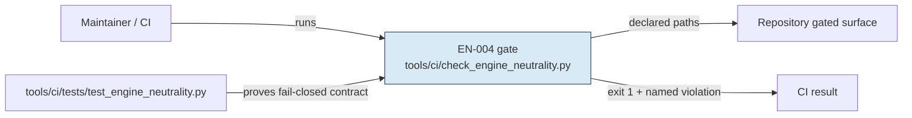

<!--
PROPOSED (not landed) — architecture-first plan-template redesign.
Integration: preserve this JSON-per-line frontmatter union and literal REQ/AC/STEP/GATE IDs; the factory parser consumes it unchanged.
-->

---
schema_version: 2
artifact: "plan"
job_id: "{{job_id}}"
cycle: {{cycle}}
status: "draft"
author_role: "engram-planner"
profiles: {{profiles_json}}
source_snapshot: null
input_artifacts: []
updated_at: "FILL: ISO-8601 with timezone"
size_tier: "S"
spec_ref: null
constitution_rules_touched: []
---

# Plan: <short observable outcome>
## Approach argument (mandatory)

Make the engineering case before listing work: name the chosen seam, explain why
it satisfies each cited `REQ-*`, consume applicable `DEC-*`, and state the
rejected alternative and its consequence inline. S tier is this argument,
steps, and at most one relevant diagram; M/L adds the architecture views below
only when they clarify a real boundary or runtime concern—never blank sections.

**Worked example — job 011.** Change the scan seam in
`tools/ci/check_engine_neutrality.py` to collect a nonexistent declared path as
a named violation. That fail-closed behavior satisfies `REQ-001`; retaining the
existing pattern scan satisfies `REQ-002`. Silently skipping the path is
rejected because it permits an unscanned engine-bearing surface to ship. No
`DEC-*` is consumed: the spec determines this gate-only shape.

## High-level architecture (M/L — system context)
Use a C4-ish context graph to show what is inside the change boundary, external
actors, and the contract crossing each boundary. This diagram answers the
ISO-42010 **context/boundary** concern; it is not a runtime sequence. For S,
omit it unless this is the one diagram needed to make the seam legible.



For job 011, the gate and its fixture are inside the boundary; repository paths
are scanned input, and CI consumes only the exit/result contract. `REQ-001`
changes the missing-path result, while `REQ-002` preserves present-path behavior.

## Technical architecture (M/L — components and runtime flow)
Name concrete components and the implementation seam, then add a separate
control-flow or sequence view for the runtime concern. Do not use a context
diagram to imply execution order. The component view below owns the
**structure/responsibility** concern; the sequence owns **failure control flow**.

```mermaid
flowchart TB
  Scan[scan()\ncheck_engine_neutrality.py] --> Exists{declared path exists?}
  Exists -->|yes| Patterns[existing prohibited-pattern scan]
  Exists -->|no| Violations[append named missing-path violation]
  Patterns --> Result[aggregate violations and exit]
  Violations --> Result
```

```mermaid
sequenceDiagram
  participant CI as CI runner
  participant Gate as check_engine_neutrality.py
  participant FS as declared gated path
  CI->>Gate: run EN-004
  Gate->>FS: exists()?
  FS-->>Gate: missing
  Gate-->>CI: exit 1; name missing path
```

In the worked example, collection joins the existing violation aggregation rather
than adding a second exit path; the fixture invokes the public gate behavior,
not an implementation-only helper.

## Governed implementation, verification, and rollback (mandatory)
Order independently reviewable work so later evidence depends on earlier
behavior. Every step must cite one or more `REQ-*`; every requirement in the
referenced spec must occur in a STEP row. A new consequential choice is
`DEC-* [DELEGATED: authority]`: decision; rejected alternative; consequence.

| ID | Imperative | REQ IDs | Rule IDs | Concrete paths | Verify (GATE) | Rollback |
|---|---|---|---|---|---|---|
| STEP-001 | Collect missing declared paths as named violations without changing existing pattern checks. | REQ-001, REQ-002 | EN-004 | `tools/ci/check_engine_neutrality.py` | GATE-001 | Revert the behavior commit. |
| STEP-002 | Add present-path and missing-path fixture coverage through the gate boundary. | REQ-001, REQ-002 | EN-004 | `tools/ci/tests/test_engine_neutrality.py` | GATE-001 | Revert the fixture commit. |

Stop and escalate if the pre-fix missing-path fixture does not fail or the
post-fix fixture does not pass: that invalidates the seam argument rather than
just a test expectation. Roll back in reverse dependency order; job 011 has no
persisted state, schema migration, or partial deployment, so reverting the two
commits restores the prior gate behavior.

## Acceptance-to-evidence map (mandatory)
Every `AC-*` needs at least one STEP and a named runnable GATE. State an
approved omission/deviation explicitly; an empty cell is not evidence.

| AC ID | Step IDs | Gate IDs | Omission or authorized deviation |
|---|---|---|---|
| AC-001 | STEP-001, STEP-002 | GATE-001: `python3 tools/ci/tests/test_engine_neutrality.py` | none |
| AC-002 | STEP-001, STEP-002 | GATE-001; GATE-002: `python3 tools/ci/check_engine_neutrality.py` | none |

## Contracts and blast radius (mandatory)
State compatibility, consumers, and migration action concretely; say `none`
only with a reason. Worked example: this is a compatible internal CI-gate
behavior change. Consumers are `tools/ci/check_engine_neutrality.py` and its
fixture; no stored format, public API, or migration changes. The owned failure
shape is a false failure in a stripped checkout, surfaced as the named path.
