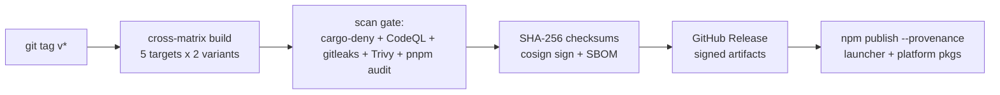

# RFC-0021: engram-mcp npm distribution — trust-first rollout

- **Status:** Proposed
- **Date:** 2026-10-18
- **Depends on:** ADR-0003 (implementation stack), ADR-0022 (engine grid)

## TL;DR

Ship `engram-mcp` as a dependency-free JS launcher plus per-platform
binary packages (`os`/`cpu`-gated, **no postinstall ever**), built by a
tag-driven release pipeline with provenance attestation, signed
checksums, SBOM, and a layered scan gate. The npm package is the floor;
the launch stack on top — one-command client registration (Claude,
Cursor, Codex, pi, Claude Desktop, **GitHub Copilot**), SDK publication,
visible security posture, demo assets, benchmark — is what turns a
package into something strangers trust and adopt.

## Context

**Product-line note:** a full agent harness is planned alongside this
engine; a future rebrand (e.g. `engram-core`) is anticipated but NOT
taken now — distribution ships as `engram-mcp`, and the future name is
registered defensively at launch time.

The server in this repo is the only consumer-facing artifact: a stdio MCP server
(Rust, ~86 MB unstripped today). CI is green and lean; `cargo audit`
passes with zero ignores; no release pipeline exists. npm's install
surface is the most-attacked path an agent tool ships on (postinstall
abuse, typosquats, binary substitution). Trust must be structural.

Reference lessons (verify current specifics before copying tactics):
**mem0** grew via SDK-everywhere + docs + falsifiable benchmarks;
**OpenClaw** went viral and was immediately attacked (malicious PRs,
typosquat pressure) — trust infrastructure must exist *before*
attention arrives.

## Goals

- `npx engram-mcp@latest --storage ~/.engram` works on linux-x64/arm64
  (gnu), darwin-arm64, win32-x64.
- Zero install scripts; launcher has zero dependencies.
- Every artifact verifiable: npm provenance, SHA-256 checksums (signed
  release), SBOM per release.
- Scan gate (cargo-deny, CodeQL, gitleaks, Trivy) must pass to publish.
- Graceful, precise failure on unsupported platforms and version drift.
- One-command client registration: `engram-mcp install --client
  <claude|cursor|codex|pi|claude-desktop|copilot>`.

## Non-goals (v1)

musl builds; `-full` (fastembed) on Windows; cargo-fuzz; auto-updates;
managed/hosted offering; telemetry of any kind (explicit product
stance); publishing anywhere beyond npm + GitHub Releases.

## Package tree

```
engram-mcp                    launcher: bin.js (zero deps) + install.ts
@engram/mcp-linux-x64-gnu     binary + package.json {os,cpu,files:[engram-mcp]}
@engram/mcp-linux-arm64-gnu
@engram/mcp-darwin-arm64
@engram/mcp-win32-x64
engram-mcp-full + @engram/mcp-*-full     fastembed variant (separate launcher)
@engram/client, @engram/node             existing TS workspace, published
```

Launcher contract: resolve platform package → spawn with stdio inherit →
exit-code passthrough. Missing package → error naming the exact install
fix; version mismatch → hard fail. `ENGRAM_MCP_BIN` env override for
development.

### Client registration matrix

| Client | Write target (verify at implementation) |
|---|---|
| claude (Code) | `.claude/settings.json` / `.mcp.json` project scope |
| claude-desktop | `claude_desktop_config.json` |
| cursor | `.cursor/mcp.json` |
| codex | `~/.codex/config.toml` |
| pi | `.mcp.json` |
| **copilot** | VS Code `.vscode/mcp.json` (workspace) + repo-root `.mcp.json` (Copilot coding agent) |

## Security pipeline



- **cargo-deny** (advisories + licenses + bans) — complements cargo-audit
- **CodeQL** — Rust + TS SAST (Rust coverage is recent; add Semgrep if TS
  findings look thin — open question)
- **gitleaks** — secret leakage
- **Trivy** — tree scan + SPDX SBOM attached to the release
- **pnpm audit** — the launcher's own (empty) dependency tree must stay
  clean
- Break-glass on scan failures: documented maintainer override with
  justification, never silent

**Account-level hardening** (the real attack surface for a
one-maintainer project): hardware-key 2FA, frozen publish tokens,
CODEOWNERS + required review on release paths, defensive npm name
registration (`engram`, `engram-mcp`, `engram-core`, `engram-harness`, `@engram` scope) *before*
announcement, SECURITY.md with coordinated disclosure.

## Binary hygiene

`[profile.release] strip=true, lto="thin", codegen-units=1`. Default
variant ships without fastembed/ONNX (target ≤ 40 MB; vector via
`--embedding-provider http` or off); `-full` carries local models.
Privacy headline — "no telemetry, ever" — must be verified by auditing
the default binary's network surface before it is claimed.

## Launch stack (phases after the package floor)

1. **install --client** + publish `@engram/client`/`@engram/node` (the
   mem0 SDK loop: server is the hook, SDK is retention)
2. **Trust visible**: badges (audit/CodeQL/provenance/signed), SECURITY.md,
   name defense, 2FA/token freeze
3. **Demo assets**: `engram-mcp viz` (the 4.5k-node 3D self-graph as a
   command), 60-second scan→recall→fetch_content→graph video, README hero
4. **Benchmark**: reproducible eval vs mem0 on memory tasks + code-intel
   tasks (verified-precision dead-code, blast radius) — numbers with
   reproduction commands
5. **Surface multiplication**: Homebrew tap, `cargo install`, ghcr
   Docker image, then `curl | sh` (signed) — each reuses release artifacts
6. **Community**: Discord, Discussions, issue templates, weekly release
   cadence with generated notes, CONTRIBUTING → AGENTS.md

Announcement is last. License: MIT today; Apache-2.0 considered for
corporate adoption before external contributors arrive (decision open).

## Alternatives considered

- **Download-on-install** — rejected: postinstall is the trust
  anti-pattern; network-required installs.
- **cargo-dist for the whole pipeline** — partial adopt candidate for the
  build matrix if hand-rolled YAML grows; decided at implementation.
- **Single mega-package with all binaries** — rejected: 10× install size,
  worse blast radius.
- **`-full` as optionalDependencies of one launcher** — lean separate
  launcher: simpler mental model, cleaner default surface.

## Risks

- ONNX/musl weakness in `-full` — gnu-only initially, documented matrix
- Typosquat race on names — register early (mitigation above)
- Windows unsigned `.exe` → SmartScreen — documented; code-signing cert
  is a later budget decision (surfaced, not hidden)
- Scan false-positives blocking releases — tuning window + documented
  break-glass
- npm provenance requires public repo + OIDC — satisfied today; flag if
  that changes

## Rollout

1. Release profile + measured size delta *(no publishing)*
2. Launcher + platform templates; local `npm pack` + `npx` verification
3. Scan-gate workflow on PRs
4. Tag-driven release workflow (dry-run mode first)
5. First tag `v0.1.0`; README trust section; name registration
6. Launch-stack phases 1–6 above; announcement last

## Open questions

1. CodeQL Rust coverage adequate day one, or Semgrep in parallel?
2. Code-signing budget for Windows (defer, document)
3. MIT → Apache-2.0 before external contributors?
