# RFC-0021: Structural code context

- **Status:** Accepted
- **Author:** Codex, on behalf of phanijapps
- **Approver:** phanijapps
- **Date opened:** 2026-10-14
- **Date closed:** 2026-10-14
- **Approval:** phanijapps approved the RFC and proposed next-step sequence in this session on 2026-10-14.
- **Decision weight:** heavy — introduces a parser extension contract and a code-to-model enrichment boundary; implementation requires explicit acceptance.
- **Related:** [ADR-0028](../adr/0028-engram-code-crate.md), [ADR-0029](../adr/0029-normalized-code-parser-port.md), [ADR-0030](../adr/0030-code-derivation-layers.md), [ADR-0022](../adr/0022-engine-grid-vs-backend-recipe.md), [RFC-0020](0020-unified-knowledge-indexing.md), [AST chunking audit](../research/ast-aware-code-chunking-audit.md)

## Reviewer brief

| Item | Brief |
| --- | --- |
| Decision | Establish a language-neutral code-context and derived-summary pipeline. |
| Recommended outcome | Accept the five decisions below, then deliver through separate specs. |
| Change if accepted | Preserve source; normalize parser output and hydrate context; generate and retrieve evidence-linked behavior summaries. |
| Affected surface | Domain contracts, code behavior, ingest, knowledge/retrieval adapters, Rust integration, N-API/TS, both MCP transports and TS maintenance. |
| Stakes | Parser mapping is reversible; persisted contracts and source migration require compatibility discipline; model enrichment sends source across a configured boundary. |
| Review focus | New-language onboarding, source coverage, summary provenance and degraded operation. |
| Not in scope | New grammars in this RFC, dynamic plugin downloads, code execution, compiler-complete analysis or automatic acceptance of product requirements. |

## The ask

Approve a shared structural representation that any registered parser can
produce, lossless source retention, bounded context hydration and optional
plain-English behavior summaries. TypeScript is an example and initial
fixture, **not the contract's language boundary**. Adding a language should
require its parser/mapping, registration and conformance fixtures; existing
chunking, storage, summaries and retrieval should consume the same contracts.

Engram already extracts AST-aware method chunks, but the audit reproduced
missing outer-function statements and class-field context. Embeddings can
represent only a prefix, and summaries are not generated by code scan. The
question is how to preserve and explain behavior across languages without
copying these gaps into a new enrichment layer.

| ID | Question | Recommendation | Why | Decide by | Reviewer action |
| --- | --- | --- | --- | --- | --- |
| D1 | What may language parsers expose? | A registered provider returning normalized structural facts and feature coverage. | Adding parsers does not require language branches in shared consumers. | RFC acceptance | Confirm the provider seam and ADR-0028 follow-up. |
| D2 | What is retained? | Revision-grounded source snapshots plus semantic units and context/residual chunks. | Complete source survives omitted or unsupported syntax. | RFC acceptance | Confirm snapshot storage and index exclusions. |
| D3 | How is context supplied? | A shared, policy-checked context operation over source and graph facts. | Parent/dependency context stays consistent across transports. | RFC acceptance | Confirm context contract and bounded omission reporting. |
| D4 | How is large code indexed? | Model-aware structural segments with explicit partial/fallback status. | A prefix vector is not complete behavioral coverage. | RFC acceptance | Confirm token-budget and indivisible-node handling. |
| D5 | How are explanations produced and served? | Optional TS LLM generation, Rust validation/persistence, and source-linked retrieval. | Keeps deterministic behavior in Rust and LLM integration in TS. | RFC acceptance | Confirm summary lifecycle, egress policy and parity. |

All decisions are owned by phanijapps and are approved as the architectural
direction. Follow-on specs define implementation contracts and delivery gates;
acceptance does not select a model or install additional parsers.

## Problem & goals

Current Tree-sitter scanning stores complete leaf methods with qualified
anchors. The containment/import graph is separate from chunks. A declaration
with any declaration descendant is reduced to its first signature line;
this also affects executable functions containing nested functions. Imports,
fields, initialization and some top-level statements are not guaranteed to
be represented in those semantic chunks. A source span covering a declaration
is therefore not evidence that its stored text covers that declaration.

The MCP embedding path caps new input at 8,192 characters. Its scan-side
lexical feed indexes entity names and kinds. Neither fact establishes full
implementation retrieval. The detailed [audit](../research/ast-aware-code-chunking-audit.md)
contains source references, a live reproduction and test results.

Goals:

- Retain every byte of an accepted UTF-8 source file with exact source identity.
- Preserve executable units, including outer statements around nested units.
- Make parser engines, languages and feature coverage separately discoverable.
- Retrieve a unit with its signature, enclosing context, relevant dependencies
  and honest resolution/coverage status.
- Generate optional, traceable behavior explanations for nontechnical users.
- Carry the same stored/query capabilities across supported backends and transports.

Non-goals: implementing new language grammars now; runtime loading of
untrusted parser binaries; fetching/building dependencies to resolve imports;
executing source; guaranteeing complete static call/type resolution; inferring
an entire business process from one method; automatically promoting inferred
requirements into accepted requirements. A PM-facing UI is a later consumer.

## Proposal

### D1 — Parser providers and a common structural model

Introduce a `CodeParser` port and normalized result in `engram-code`. The
port takes caller-provided source plus explicit language/parser selection and
returns structural facts. Filesystem discovery, git, provider construction,
process/network I/O and persistence remain in adapters/hosts. Built-in
Tree-sitter parsing stays pure; a future compiler/LSP integration performs its
I/O in an adapter and supplies normalized results to the same core behavior.
No Tree-sitter `Node`, compiler object or grammar-specific required field
crosses the neutral result boundary. Optional namespaced diagnostic labels
are permitted, but consumers cannot depend on them for behavior.

This intentionally revisits ADR-0028's decision to defer a parser port. The
user's requirement for additive parser support makes the seam a concrete
contract rather than an assumed permanent single engine. Acceptance leads to
an ADR recording this extension; it does not edit the accepted ADR's body.
Existing grammar dependencies can remain in `core/code` during the first
cutover. When a second parsing engine is implemented, parser implementations
move behind the port into focused adapter cells, as ADR-0028's revisit clause
requires. Identity, normalization validation, coverage, segmentation and
resolution remain deterministic code behavior.

The following are **proposed contract concepts**, not types claimed to exist
in the current checkout. Exact schemas are a follow-on spec responsibility.

| Concept | Required semantics |
| --- | --- |
| `LanguageDescriptor` | Open, validated `languageId` string; aliases, extensions/path hints, dialects and supported parser IDs. A new language does not add a Rust/TS language enum variant. |
| `ParserDescriptor` | Parser ID/version, grammar or equivalent build fingerprint, mapping version and a feature report. |
| `ParsedCode` | Source digest, language/parser descriptors, units, structural facts, diagnostics and coverage. |
| `CodeUnit` | Local unit ID, logical name/enclosing chain, neutral role, declaration/name/signature/body/doc spans where available, parent unit and structural split boundaries. |
| `CodeFact` | Typed containment, import binding, member/type hint, inheritance and call/reference facts with spans and resolution status. Reuse current typed code edges where applicable. |
| `CodeCoverage` | Parse quality and per-feature status, accepted source span, preserved snapshot coverage and normalized-fact coverage. |

Neutral roles distinguish callable, container, member, initializer and
residual source. A parser may retain a namespaced syntax label for diagnostics;
shared behavior must not interpret that label. Unsupported syntax maps to
preserved residual source, not an invented semantic fact. Truly new semantics
require a reviewed contract extension; a new language using existing roles
and facts does not.

Feature coverage is explicit for symbols, complete signatures, doc comments,
members/initializers, imports/bindings, references/calls and structural split
points. Status is supported, partial or unsupported, with diagnostic reasons.
Parse quality independently distinguishes clean, recovered, fallback and
failed. Missing facts from an unsupported feature mean **unknown**, not an
empty dependency set. Syntax-only references do not imply semantic resolution.

Registration is host composition of compiled, trusted providers. Detection
uses the registry's extension/path rules in both file discovery and parsing,
so a new extension is not filtered out before its parser runs. Explicit
language/parser overrides win; unavailable explicit overrides fail with a
typed error. Ambiguous auto-detection requires a configured choice or reports
ambiguity. There is no registration-order tie breaker or silent parser swap.
Resource limits cover file bytes, nodes/depth, parser memory and parse time at
the host. The provider accepts a cancellation/budget contract; timeout or
cancellation stops work and reports rejected/incomplete input. A provider must
demonstrate enforceable allocation/time limits and cooperative cancellation for
in-process bounded scans. Where that cannot be demonstrated, the host uses a
supervised, resource-limited parser worker or rejects that provider for bounded
scans. A noncooperative thread left running after a timeout is not enforcement.
The worker parses source; it does not execute the indexed program. Rejected
files are reported, not counted as indexed.

**Adding a language:** supply a provider/grammar and a mapping to the common
model; declare feature coverage; register detection rules; pass common fixtures
and language-specific fixtures; publish it in capabilities. No edits to shared
summary prompts, context assembly, retrieval fusion or storage recipes should
be required. Dependency additions still follow repository review rules.
Registration is configuration/build extensibility, not a promise of hot-loading.

### D2 — Source snapshots and semantic chunks

For each accepted UTF-8 file, retain an immutable, revision-grounded snapshot
through existing knowledge document/chunk repository ports. Use `CodeBlock`
chunks for source snapshots and existing `CodeSymbol`/`CodeBlock` kinds for
semantic units. Large snapshots may be stored in ordered ranges; their exact
concatenation must reproduce the input and content hash. They are source
storage ranges, not semantic embedding chunks. Binary/non-UTF-8 input is
explicitly rejected or reported as unsupported; lossy decoding does not meet
this guarantee.

Propose an optional typed code descriptor on `KnowledgeChunk`, introduced
through the domain model and generated contracts. It records role
(`source_snapshot`, `symbol`, `container_context`, `residual`,
`retrieval_segment`, `behavior_summary`), source digest, parser/mapping
fingerprint, unit/parent references, ordered source spans and completeness.
A compound context chunk distinguishes its rendered text from the ordered
source slices it represents. Enclosing declaration span and actual text
coverage are separate. These semantics must not hide in arbitrary metadata.

Snapshot records share their document/source's policy and retraction
lifecycle. They are excluded from embedding, BM25 and normal recall candidate
feeds; explicit source/context reads can fetch them. Semantic chunks retain
complete callable bodies even when nested declarations also get chunks.
Accept this bounded duplication rather than deleting outer behavior.
Containers retain a complete declaration header plus field/initializer context;
residual ranges preserve syntax not assigned to a semantic unit. The snapshot
remains the recovery source even if a parser cannot classify residual code.

Coverage has two independent guarantees: accepted source is fully retained;
semantic extraction has declared capabilities and omissions. Snapshot
retention alone does not justify reporting complete behavioral extraction.
Graph identity/resolution rules remain unchanged; repo/path disambiguators
stay outside logical entity names, per RFC-0020.

### D3 — Context hydration

Add a policy-checked `CodeContext` operation accepting a symbol/entity/unit
reference, source version and limits. It combines the canonical unit with
existing containment/import graph links and normalized source facts:

- Logical/qualified symbol, language, full multiline signature and doc text.
- Enclosing declaration chain and relevant members/initializers/constructor units.
- Import bindings, aliases and local dependency references, with exact source spans.
- Resolved graph targets or explicit external/unresolved/unsupported status.
- Repository/path, observed revision plus content digest, parser/mapping version.
- Included ranges, omitted context and why, and parse/feature coverage.

A field bound to an imported type can be represented as a source-grounded
association without claiming that a syntax parser resolved the type system.
If a provider cannot establish relevance, return bounded file-level imports
labeled as file context. Context budgets never silently drop dependencies:
omissions are reported and callers can request more. Primary source and
context dependencies must match the requested source view; source reads do
not fetch the current working tree as a substitute for the indexed snapshot.
For dirty/non-git files, the digest is authoritative and a commit revision is
optional provenance, not fabricated.

Reuse existing graph facts; the operation assembles a view rather than a
second graph. Hydration uses core contracts and knowledge ports, with a thin
integration facade. Scope and policy checks apply independently to every
hydrated source; traversal does not widen access. Unavailable external code
stays unavailable, with degradation reported in the result.

### D4 — Model-aware segments

Keep the complete canonical unit; derive separate indexable segments using
its structural split boundaries and the embedding adapter's tokenizer/model
input limit. The adapter reports tokenizer identity, reserved prompt/special
token overhead and effective maximum input. Core segmentation uses an injected
budget measurer; no model dependency enters `engram-code`.

Prefer whole functions/methods that fit, then statement/block boundaries for
oversized units. Every segment links to the unit, source range and context.
After rendering signature/parent context, measure the **entire submitted text**
against the effective limit. Headers consume the budget too. Do not replace
complete source with a model prefix or allow a provider to truncate silently.

An indivisible oversized node, such as a long literal, may be split into
UTF-8-safe text ranges, explicitly labeled non-structural fragments. If even
minimal context cannot fit, omit it with a reason or report the segment as
not embeddable; source remains available. Fragment/segment coverage must
account for all eligible unit text, including inter-node gaps. Model/tokenizer
or rendering changes invalidate derived segments and vectors through a
versioned indexing fingerprint. Unknown model limits yield a reported vector
coverage failure, not an invented universal token budget.

Index method text/comments, context/residual text and later summaries through
appropriate retrieval adapters. Snapshot-only records are excluded. Aggregate
segment hits by the canonical unit before diversity limits, with evidence
ranges retained, so a huge function does not crowd out all other results.
Reuse existing fusion/context composition rather than reimplementing RRF.

### D5 — Silver summaries and PM-facing retrieval

The medallion terms describe logical derivation stages, not new stores:

```mermaid
flowchart LR
    S[Revision-grounded source] --> P[Registered parser]
    P --> N[Normalized structural facts]
    S --> B[Bronze: snapshots and units]
    N --> B
    B --> C[Policy-checked CodeContext]
    C --> T[TS maintenance and injected LLM]
    T --> V[Rust validation and persistence]
    V --> SI[Silver: behavior summaries]
    B --> R[Existing retrieval adapters and fusion]
    SI --> R
    R --> G[Gold: PM views with source evidence]
```

Bronze is source plus deterministic units/graph. Silver is derived behavior
knowledge. Gold is a feature/process/requirement view over Silver and supporting
code/docs; it labels observed behavior separately from inferred intent.

Use an optional TS maintenance `summarize-code` operation with the existing
injected `LlmProvider` through `complete` with an explicitly empty tool list,
never `completeAgent`. Parse response text against the strict JSON response
schema; any nonempty `toolCalls` result or request for further actions is
invalid output and is never dispatched. Input is bounded `CodeContext`, not arbitrary raw files
or the entire repository. Structured output contains a concise explanation,
inputs/outputs, effects, conditions/error behavior, evidence references and
limitations. A single generic prompt consumes the normalized contract;
language-specific syntax belongs in providers, not per-language summary code.
The model must not invent caller intent or external API guarantees.

Persist each summary as a separate `KnowledgeChunk` of existing kind
`StructuredRecord`, with role `behavior_summary` and a typed summary payload.
Its text is the plain-English retrieval representation; its provenance uses
existing `DerivationKind::Summarization` and `EvidenceRef` inputs. The original
unit text is unchanged. The existing optional `KnowledgeChunk.summary` is
not the authoritative record for versioned structured summaries.

A deterministic Rust code-summary service prepares allowed inputs and accepts
validated output through knowledge ports. It checks schema, evidence IDs and
ranges, caller scope, and expected source/context digest before writing.
Syntactic evidence validation does not prove a model's claim is true; evaluation
and attribution remain required. Rust embedders can prepare/read/write
summaries without a Rust LLM client; TS performs generation, and both MCP
transports expose the same prepare/commit/query operations. Generation is an
optional integration workflow, not a Rust runtime capability falsely reported
as supported merely because summaries can be stored.

The summary schema is versioned and strict: reject unknown fields, unknown
versions, overlong text and excess effects/evidence entries. The spec fixes
finite per-field/count limits. Every evidence target and range must belong to
the exact prepared input set; an existing readable chunk outside that set is
not valid evidence for this job. Every accepted claim carries supporting
references or is explicitly marked an unresolved limitation. Invalid output
sets the attempt to failed; it never becomes a ready summary.

Summary identity includes scope/source unit, all included dependency hashes,
parser/mapping and context-rendering versions, summary schema, model/provider
identity and prompt hash. Repeated writes for that key are idempotent; changed
inputs produce a new derivation. Track missing, pending, ready, failed and
stale states. At commit, reject stale prepared inputs. At retrieval, current
views exclude stale summaries but return source with a reason; explicit
historical views require matching evidence. Invalidate on changes to included
parent/dependency context as well as the primary method. Source deletion or
policy restriction cascades to summary visibility, chunks and index entries;
no derived artifact remains more accessible or longer retained than its inputs.

In-process local retrieval embeddings are distinct from external enrichment:
an explicitly local adapter may process current, policy-authorized semantic
code chunks under vector enablement. Snapshots and legacy code without a
validated generation remain excluded. Locality is an adapter contract, never
inferred from a provider-name string. Scope, policy, expiry and generation are
checked before inference and vector insertion. This clarification follows the
user's explicit local-code-embedding instruction of 2026-10-14; it grants no
external source transmission or summary generation.

External enrichment defaults off. An explicit job config selects the provider and
finite input/output tokens, units, concurrency, wall time, retry and spend
limits. A neutral policy authorizer must approve enrichment and destination
for every included source; retrieval permission alone is not consent to send
source to an external provider. The required neutral authorization contract is
`authorize_code_enrichment(requester, jobScope, inputVersions,
destination, limits) -> AuthorizedCodeEnrichment | Denied`. The destination
binds canonical provider ID, model ID and an endpoint/transport profile from
trusted host configuration. A model alias must resolve before authorization;
unknown destinations, legacy inputs without an explicit source-level
enrichment grant, or any denied input deny the whole enrichment attempt.
Provider destinations cannot be chosen from source content or model output.

Preparation records an expiring authorization ticket bound to a unique job ID,
requester identity, input and policy digests, exact scope, canonical destination
and job limits. An atomic attempt-reservation operation in the shared job
service consumes call/token/cost budget before each outbound attempt. The
trusted host enforces a durable ledger across workers and ticket reuse:
concurrency, retries and total spend are job-wide, not reset by each call.
Attempt keys are idempotent; replaying a claimed key never authorizes a second
egress. Reserve a configured worst-case cost for each attempt; unknown usage
after a timeout remains reserved rather than automatically refunded. Cancelled,
expired or exhausted jobs deny further attempts. Remote exactly-once execution
is not claimed. The trusted
TS execution host obtains the actual endpoint/model from its configured
provider, verifies they match the ticket and rechecks authorization before
egress. Redirects/endpoint changes are denied unless independently authorized.
Commit rechecks input versions, authorization and ticket binding before
persistence. This is an execution-host obligation, not a claim that Rust can
prove where an arbitrary external caller sent source. Existing read/write
authorizers are reused where applicable; the new typed enrichment check and
source-level grant must be defined in the domain spec before generation ships.

The authorized destination profile also declares provider-side data use,
training use, retention bounds and deletion support. These must satisfy every
input's explicit enrichment grant and policy; unknown or incompatible terms
deny egress. Engram retraction governs its own artifacts and cannot promise
deletion of provider-held copies. If a provider cannot retract submitted source,
the grant must explicitly allow that retained copy under the profile's bounded
terms; policies requiring retractable processing deny such a provider. Record
the profile version with the attempt so changing provider terms triggers fresh
authorization rather than reusing an old ticket.

For the first version, every input must have exactly the same `Scope` tuple as
the job and derived record. Hydration may display authorized cross-scope
context, but it must not feed that combination into summary generation. Reject
incompatible scopes; do not union them or choose the broadest. Within that scope,
the derived policy takes the most restrictive representable visibility,
intersection of allowed uses/destinations and earliest expiry, and retention
cannot exceed any input's permitted lifetime. Legal-hold/conflicting retention
or any policy intersection that cannot be represented causes denial rather
than an approximated wider policy. The write service computes these values;
the model/caller cannot supply a looser derived scope/policy. Logs contain IDs,
counts and error categories, not source, secrets or full prompts.

Source/comments are untrusted prompt data. Delimit them and instruct the model
to treat them as data; expose only the structured response schema and no
execution/network/file tools. Validate output and evidence before persistence;
never run returned code or let model text select paths, URLs or credentials.
Read-side context labels Silver as model-derived so it cannot masquerade as
instructions or authoritative requirements. Source is sent only through the
configured provider seam; a code import/URL is never a provider destination.

Retrieval returns explanation, symbol, source version, relevant source/context
ranges and derivation status. Missing summaries, vector failures or unsupported
parser features degrade with explicit reasons; source/lexical/graph lanes
continue. New deterministic operations must be wired through Rust integration,
N-API, generated TS/client interfaces, Rust MCP and TS HTTP MCP. Prefer existing
`code` and maintenance discriminators over independent tools. Capability
reporting distinguishes available language parsers, per-feature context support,
source coverage, summary storage/query support and configured generation.

### Compatibility and rollout

Update `docs/domain-data-model.md` before Rust/public schemas, then regenerate
contracts. Proposed optional code/summary descriptors are additive on the wire
for readers accepting unknown fields, but are **not universally compatible**:
strict old schema validators can reject them; new Rust struct fields require
workspace caller changes. Version/opt-in new operations and preserve existing
response projections until consumers negotiate the extended schema. Keep
legacy chunks readable with coverage `legacy_unknown`; never infer completeness
from their location spans. No new serialized chunk-kind variant is needed.

Version scan manifests by parser, grammar/mapping and chunk-policy fingerprint,
not only source bytes. Updating a parser must reindex unchanged files that used
it. Re-scan affected sources to build snapshots/units and reconcile old chunk,
entity and vector references through existing source retraction semantics.
Preserve logical entity identity where feasible; recomputed chunk IDs are
content/version-bound and must be remapped for derived references. Export/import
must round-trip typed descriptors, source snapshots, summary provenance and
status through the existing format/services, or report unsupported extensions;
silent metadata loss is not acceptable.

Use explicit activation per source/scope. Readers and role-aware index
selectors land before snapshot writers. A typed `CodeSourceGeneration` manifest
in the knowledge adapter, behind a neutral knowledge port, is the authority
for `(scope, stable source key)`: generation ID/fingerprint, source digest,
status (`updating`, `incomplete`, `active`) and expected record coverage. The
same port provides atomic compare-and-set updates within that adapter; it does
not promise a transaction with vector or lexical stores. Code records and
index entries carry their owning source key and generation, through typed
descriptors/source references. Graph records with several source owners are
eligible only for a currently active contribution, not because another
source's generation happens to be active.

Before mutating an existing source view, atomically mark it updating with the
new generation. During updating/incomplete, current reads omit that source and
report a source failure; this default deliberately accepts temporary source
unavailability rather than serving an old view while its stable graph IDs are
being overwritten. Activate only after source/chunk/graph writes and coverage
validation for the expected generation succeed; derived vectors/summaries may
remain pending. Source, context and graph reads check manifest eligibility.
Lexical/vector/graph candidate lanes filter inactive or mismatched generations
before fusion and recheck included manifests before returning a response;
changed manifests cause those items to be dropped with a degradation reason.
Filtered candidate exhaustion is reported rather than filled with stale hits.
Explicit historical reads must load a retained matching snapshot/generation
and evidence set; absence returns unavailable, not a current-view substitute.

Retries reuse the pending generation and content-derived IDs, finish required
writes, then compare-and-set to active. A superseding scan prevents an older
attempt from activating. Partial index writes are harmless to current reads
because generation filtering excludes them; stale projections are later
retracted/rebuilt idempotently. Writes across stores remain BestEffort; no
ACID claim or cross-store rollback. Source-level failure does not fail other
sources or unrelated memory recall. All readers must implement this selection
rule before enabling the writers.

Rollback disables enrichment and new writers while extended readers remain.
A binary predating role-aware filtering must not open a migrated store as if
snapshot records were ordinary recall/embedding inputs; enforce a minimum
reader/index-policy version or restore a compatible backup. Derived outputs
can be rebuilt; retained source and established retraction rules remain intact.

## Options considered

These are independent choice axes, not an invented list of competing whole
systems. The categories exhaust each stated axis; the current behavior is
included on each. Combinations are judged against the goals above.

| Decision / axis | Alternatives | Recommended tradeoff and prior art |
| --- | --- | --- |
| D1: provider output abstraction | Keep engine-specific API; normalized facts; full common syntax tree. | Normalized facts. Full trees bind consumers to more syntax detail; status quo requires language branching. Monaco's provider/result contract supports the boundary pattern; ADR-0028 records the port alternative. |
| D1: port introduction timing | Add the port now; defer it until a second engine, as ADR-0028 currently does; never introduce it. | Add it now to make the requested extension interface testable. Deferral preserves the accepted YAGNI tradeoff but leaves future consumers coupled to grammar APIs; never adding it contradicts parser interchangeability. Record the changed decision in a follow-on ADR. |
| D1: port ownership | Deterministic code behavior (`engram-code`); I/O orchestration (`adapters/ingest`); host/SDK integration. | `engram-code` owns normalized types/port; hosts compose implementations and adapters own I/O. ADR-0028 and the repository behavior/adapter separation ground this choice; orchestration/SDK ownership would strand pure core consumers. |
| D2: retained source authority | Current declaration-only text; semantic+residual chunks without snapshot; snapshot plus semantic chunks. | Snapshot plus semantic chunks costs storage but makes source completeness independently verifiable. Current audit disproves declaration-only coverage; Tree-sitter byte spans support exact slices. |
| D3: context assembly owner | Caller; ingestion-time duplicated context; shared query-time hydration. | Shared hydration has read cost but enforces consistent scope/version/omissions. Existing Engram graph ports and context composition are the reuse point. |
| D4: over-budget unit outcome | Prefix/truncate; exclude from vectors; preserve source plus segmented vectors. | Segmented vectors improve coverage with extra index entries; exclusion remains an explicit failure outcome. LlamaIndex demonstrates structural recursion and oversized-leaf fallback; tokenizer documentation establishes explicit limits. |
| D5: explanation lifecycle | Raw code only; transient explanation; persisted versioned summaries. | Optional persisted summaries add model cost and invalidation work, but support repeated PM retrieval with evidence. RFC-0020's TS maintenance and W3C derivation are the precedents. |
| D5: validation/persistence ownership | TS generation layer owns both; Rust core/ports own validation and persistence orchestration; backend adapter owns validation as well as writes. | Rust checks shared invariants and ports orchestrate; TS calls the model, adapters persist. RFC-0020 and ADR-0022 ground the split. TS-only checks create transport asymmetry; backend-owned checks duplicate deterministic policy across engines. |

**Do nothing** is the current combination: grammar-specific chunking,
declaration text only, caller-assembled context, prefix embeddings and no code
summaries. It avoids migration/model cost but leaves reproduced source loss
and does not meet the requested language-extensible PM explanation pipeline.
A smaller source-coverage-only fix is useful and is the first rollout slice,
but does not satisfy D1/D3/D5 by itself.

## Risks & what would make this wrong

| Failure / drawback | Response or falsifying evidence |
| --- | --- |
| Normalization hides language-specific behavior. | Residual source and unsupported-feature statuses remain visible. If a new language needs shared consumers to branch on its ID, revise the model before claiming conformance. |
| Snapshot/body/segment duplication increases storage and index dominance. | Snapshot index exclusion, per-unit hit aggregation and explicit storage/index measurements. Revisit retention layout if representative repos exceed declared budgets. |
| Symbol context spans multiple incompatible revisions. | Digest every included input and use a coherent source view; reject stale commits. An observed mixed-version summary fails validation. |
| Imports/type hints are overclaimed as resolved dependencies. | Preserve evidence and resolution status. Do not infer an external database contract from `db.query`. |
| Summary hallucinations become product requirements. | Label derivation/inference, retain evidence and evaluate groundedness; Gold cannot silently promote a model statement to an accepted requirement. |
| Source exfiltration or prompt injection. | Destination authorization, bounded inputs, no model action tools, validated writes and policy-derived visibility. An adversarial comment that changes destinations or authority fails the slice. |
| A new parser still requires central edits. | Discovery and capabilities derive from registration; conformance requires a test-only new language with no shared-consumer edits. |
| Reindex failure loses usable prior results. | Staged active view, explicit incomplete state and idempotent recovery; adapters do not pretend to supply cross-store transactions. |

The decisive unproven assumption is that normalized context produces sufficiently
accurate explanations across language idioms. The live polyglot spike tests
current structural output only, not the proposed provider API or summary
quality. Keep enrichment optional and require the evaluation below before
advertising the Silver workflow.

## Evidence & prior art

The [audit](../research/ast-aware-code-chunking-audit.md) verifies method storage,
outer-body loss, absent context and the embedding cap. A new live
TypeScript/Python/Rust scan ingested all three fixture files with zero errors
and preserved multiline leaf signatures/bodies under qualified method anchors.
The findings and reproduction details are in [RFC notes](0021-notes/evidence.md).
This supports normalization feasibility, but is not proof of a new parser port.

Repository foundations are [ADR-0028](../adr/0028-engram-code-crate.md),
[ADR-0022](../adr/0022-engine-grid-vs-backend-recipe.md),
[RFC-0020](0020-unified-knowledge-indexing.md),
[engram-code's shipped spec](../specs/engram-code/spec.md) and the existing
[TS extraction workflow](../../packages/runtime/src/maintenance/extract_knowledge.ts).
Prior ADR bodies remain unchanged. ADR-0029 records the approved partial
supersession of ADR-0028's parser-port deferral.

External sources checked on 2026-10-14:

- [Tree-sitter basic parsing](https://tree-sitter.github.io/tree-sitter/using-parsers/2-basic-parsing.html) describes byte/row positions and named syntax nodes. Tree-sitter technically produces a concrete syntax tree; this RFC uses “AST-aware” for structural extraction from it. Its [introduction](https://tree-sitter.github.io/tree-sitter/) describes useful recovery results despite syntax errors, supporting explicit parse-quality reporting.
- [Monaco DocumentSymbolProvider](https://microsoft.github.io/monaco-editor/typedoc/interfaces/editor_editor_api.languages.DocumentSymbolProvider.html) returns a shared [DocumentSymbol](https://microsoft.github.io/monaco-editor/typedoc/interfaces/editor_editor_api.languages.DocumentSymbol.html) shape with hierarchy and ranges. This is provider-boundary precedent, not a sufficient Engram parser contract or an LSP implementation commitment.
- [LlamaIndex CodeSplitter source](https://github.com/run-llama/llama_index/blob/main/llama-index-core/llama_index/core/node_parser/text/code.py) accepts a parser and recursively splits syntax with character/token budgets and an oversized-leaf fallback. Reuse the pattern, not a Python dependency.
- [Hugging Face Tokenizers v0.20.3](https://huggingface.co/docs/tokenizers/v0.20.3/api/tokenizer) documents explicit truncation length and overflow stride. It grounds token-limit awareness; it does not establish a universal embedding limit or require that library.
- [W3C PROV-DM](https://www.w3.org/TR/prov-dm/#component2) models derivation between source and generated entities. Engram's existing provenance contracts supply the implementation foundation.
- [OWASP prompt injection guidance](https://genai.owasp.org/llmrisk/llm01-prompt-injection/) covers indirect instructions in external content, limited privileges, output validation and separating content from instructions. It grounds the code-comment/model boundary above.

## Experiment / validation

Each delivery spec has deterministic contract fixtures and live MCP/SDK checks.
The proposed parser port and enrichment workflow are not validated by existing
chunker tests alone.

| Gate | Required result |
| --- | --- |
| Parser extension | A test-only fourth language/provider is registered and processed by unchanged chunk/context/summary/retrieval consumers. Removing it produces explicit unsupported status. Duplicate/ambiguous detection is deterministic. |
| Polyglot conformance | TS, Rust and Python fixtures cover multiline signatures, nested callables, fields/initializers, imports/aliases, comments and executable top-level code; all accepted bytes reconstruct exactly. Existing languages retain current coverage or report any reduced feature explicitly. |
| Source preservation | The audited `checkout` error/fee/return statements survive; `UserService` context includes its field, constructor, both full methods and `Database` binding. |
| Parse and size limits | Recovery trees, unsupported extensions, empty input, Unicode/CRLF and indivisible oversized nodes preserve source or explicitly reject it. Every submitted embedding fits its actual tokenizer budget; late-body search retrieves supporting segments. |
| Summary correctness | Stubbed structured responses exercise prepare/commit, schema/evidence rejection, idempotency, dependencies, source races, staleness and deletion. Real configured generation is separately evaluated for groundedness. |
| Policy/security | Cross-scope evidence, unauthorized destinations and malicious source comments cannot widen access or trigger actions; logs do not expose source/prompts. |
| Transport/backend parity | Rust integration, N-API/TS and both MCP transports expose the same deterministic operations with truthful capability/degradation reports. Supported backend recipes pass source/context/summary round-trips. |
| Migration/recovery | Old chunks remain readable, parser-version changes requeue unchanged files, mixed active generations are prevented, and interrupted re-scan/reindex resumes without unsupported rollback claims. |

For the Silver pilot, use at least 30 source-grounded behavior examples split
across TS/Rust/Python, including external dependencies, nested units and large
methods. phanijapps owns the pilot corpus and scoring rubric before the pilot
starts. Proposed release threshold: at least 90% of examples correctly describe
observable behavior and cite supporting ranges; zero unsupported assertions
about authorization/business intent or external guarantees; relevant source
appears in the top five results for at least 90% of paired lexical/plain-English
queries. These are proposed acceptance targets, not measured results. A miss
keeps generation experimental/off by default while source fixes can ship.

## Open questions

1. Which additional language should be the first real onboarding exercise?
   Recommended default: the next language required by a user repository,
   selected after the test-only-provider gate. Owner: phanijapps;
   decide-by: parser-provider implementation spec. The shared contract and
   baseline TS/Rust/Python fixtures do not depend on that choice.
2. Which model/provider and operational budgets should the Silver pilot use?
   Recommended default: the existing injected TS provider selected explicitly
   per job, with finite budgets recorded in the pilot spec. Owner: phanijapps;
   decide-by: Silver pilot start. This Draft selects the seam, not the model.

## Follow-on artifacts

After acceptance:

1. [ADR-0029](../adr/0029-normalized-code-parser-port.md) records the normalized
   parser port and ADR-0028's revisited placement rule;
   [ADR-0030](../adr/0030-code-derivation-layers.md) records the logical derivation boundaries.
2. [Code source preservation](../specs/code-source-preservation/spec.md) defines
   nested-callable coverage, snapshots, typed roles/ranges, versioned manifests
   and compatible re-scan/retraction, with an [implementation plan](../specs/code-source-preservation/plan.md).
3. Author a parser/context spec for the registry, normalized facts, capability
   reports, hydration and public parity. Update the domain model first.
4. Author a segmentation/retrieval spec for tokenizer budgets, coverage, lexical
   implementation text, hit aggregation and live large-method queries.
5. Author a Silver spec for prepare/commit contracts, summary storage/provenance,
   invalidation, enrichment authorization, TS generation and the pilot.
6. Link these specs from the backlog; update product documentation only as each
   capability ships. Gold UI/process aggregation remains a separate proposal.

Implementation uses the repository contract/neutrality preflight and work-loop
gates, with live store verification for every Engram behavior change. This RFC
changes no accepted contracts, generated files or runtime code by itself.
